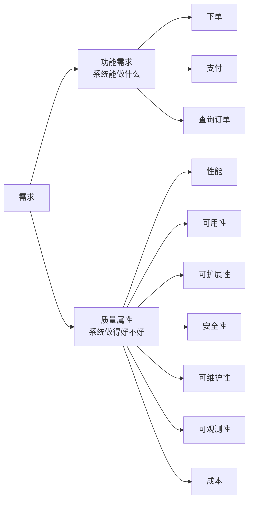
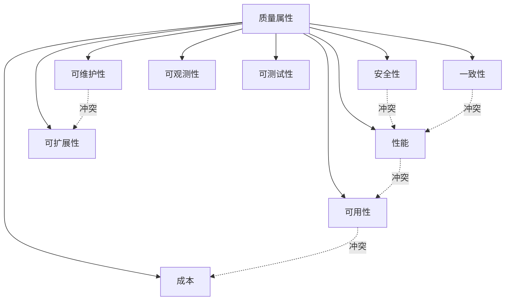
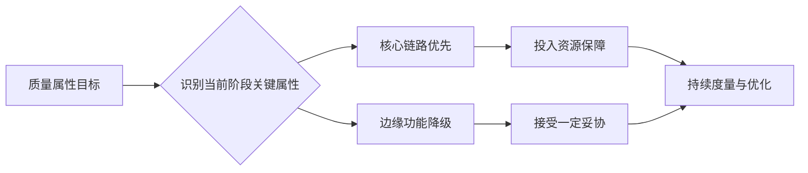

# 质量属性：功能之外，架构真正关心什么

> 本文是「架构设计」板块的第 3 篇。  
> 适合人群：3～8 年开发者、技术负责人、架构师预备役。  
> 关键词：质量属性、非功能需求、性能、可用性、可扩展性、安全性、可观测性、成本。

---

前两篇我们聊了：

- 架构是什么：一组在约束下的关键决策；
- 架构师能力模型：从写代码到做决策。

但你会发现，这两篇都反复提到一个词——**质量属性**。

为什么它这么重要？

因为**功能决定系统能做什么，质量属性决定系统做得好不好。**

一个订单系统，谁都能写出来：下单、支付、发货、退款。  
但为什么有的系统能撑住双十一，有的系统一到大促就崩？  
为什么有的系统改一个需求只要一天，有的系统改一个需求要一个月？

差别不在功能，而在质量属性。

---

## 一、什么是质量属性

质量属性（Quality Attribute），也叫非功能需求（Non-Functional Requirement，NFR）。

它描述的是：

**系统在提供功能的同时，还要满足哪些“做得好不好”的标准。**

比如：

- 功能：用户可以下单。
- 质量属性：下单接口 99% 的请求在 200ms 内返回，峰值支持 1 万 QPS。

再比如：

- 功能：用户可以查询订单。
- 质量属性：订单查询服务可用性 99.99%，故障后 5 分钟内恢复。

功能是“有没有”，质量属性是“好不好”。

**图 1：功能需求与质量属性的关系**

---

## 二、为什么质量属性这么难

因为它有三个天然难点。

### 1. 难度量

“系统要快”——多快？  
“系统要稳”——多稳？  
“系统要安全”——防谁？

质量属性如果不能用数字表达，就无法验证，也无法决策。

### 2. 难取舍

质量属性之间经常互相冲突：

- 性能 vs 一致性
- 可用性 vs 成本
- 安全 vs 易用
- 扩展性 vs 简单性
- 交付速度 vs 可维护性

架构师的工作，就是在这些冲突中找到平衡。

### 3. 容易被忽略

功能需求通常有明确验收标准，质量属性往往没有。

结果就是：

- 上线前没人管；
- 上线后出问题；
- 出问题后才发现质量属性根本没定义。

---

## 三、质量属性的场景化表达

质量属性必须场景化，否则就是空话。

一个质量属性场景通常包含六要素：

| 要素 | 说明 | 示例 |
|---|---|---|
| 来源 | 谁触发 | 用户、定时任务、外部系统 |
| 触发 | 什么事件 | 下单请求、大促流量、机房故障 |
| 环境 | 什么状态下 | 正常、峰值、降级 |
| 制品 | 系统哪部分 | 订单服务、支付服务、数据库 |
| 响应 | 系统做什么 | 返回结果、降级、重试 |
| 度量 | 如何衡量 | 响应时间、成功率、恢复时间 |

举个完整例子：

> **来源**：用户  
> **触发**：提交订单请求  
> **环境**：大促峰值，QPS 达到 1 万  
> **制品**：订单服务  
> **响应**：正常创建订单并返回订单号  
> **度量**：99% 请求在 200ms 内返回，成功率 99.95%

这样表达，质量属性才可验证、可设计、可测试。

**图 2：质量属性场景六要素**

---

## 四、常见的质量属性

下面是最常见的九类质量属性。

### 1. 性能

关注系统响应速度和吞吐能力。

常见指标：

- 响应时间：P50、P95、P99
- 吞吐量：QPS、TPS
- 并发数
- 资源利用率：CPU、内存、IO、网络

关键问题：

- 平均响应时间是多少？
- 长尾请求有多长？
- 峰值能撑到多少？
- 扩容后性能是否线性提升？

### 2. 可用性

关注系统能否持续提供服务。

常见指标：

- SLA：99.9%、99.99%、99.999%
- MTBF：平均无故障时间
- MTTR：平均恢复时间
- RTO：恢复时间目标
- RPO：恢复点目标

关键问题：

- 允许停机多久？
- 故障时降级还是不可用？
- 数据能丢多少？
- 多机房还是单机房？

### 3. 可扩展性

关注系统能否随业务增长而扩展。

常见维度：

- 垂直扩展：提升单机性能
- 水平扩展：增加机器数量
- 数据扩展：分库分表、分区
- 组织扩展：团队独立交付

关键问题：

- 流量翻 10 倍能不能撑住？
- 扩容是自动还是手动？
- 有没有单点瓶颈？
- 状态怎么处理？

### 4. 一致性

关注数据准确到什么程度。

常见模型：

- 强一致：读写都看到最新数据
- 最终一致：一段时间后一致
- 因果一致：保证因果关系
- 会话一致：同一会话内一致

关键问题：

- 业务能接受最终一致吗？
- 不一致窗口多长可接受？
- 不一致时怎么补偿？
- 有没有对账机制？

### 5. 安全性

关注系统抵御风险的能力。

常见维度：

- 认证：你是谁
- 授权：你能做什么
- 加密：传输与存储
- 审计：谁做了什么
- 防攻击：SQL 注入、XSS、CSRF、DDoS
- 合规：GDPR、PCI DSS、等保

关键问题：

- 敏感数据有哪些？
- 谁可以访问？
- 怎么防止越权？
- 怎么满足合规？

### 6. 可维护性

关注系统改动成本。

常见指标：

- 变更影响范围
- 部署频率
- 恢复时间
- 代码复杂度
- 测试覆盖率

关键问题：

- 改一个需求要动几个服务？
- 新人多久能上手？
- 有没有清晰边界？
- 技术债有多少？

### 7. 可观测性

关注系统运行时能否被理解。

三大支柱：

- Metrics：指标
- Logging：日志
- Tracing：链路追踪

关键问题：

- 出问题能不能快速定位？
- 有没有告警？
- 有没有 SLO/SLI？
- 有没有全链路追踪？

### 8. 可测试性

关注系统能否被验证。

常见维度：

- 单元测试
- 集成测试
- 契约测试
- 端到端测试
- 混沌工程

关键问题：

- 能不能自动化测试？
- 能不能做故障演练？
- 能不能全链路压测？

### 9. 成本

关注投入产出比。

常见维度：

- 机器成本
- 云服务成本
- 人力成本
- 运维成本
- 机会成本

关键问题：

- 单位请求成本是多少？
- 资源利用率如何？
- 有没有过度设计？
- 有没有 FinOps 治理？

**图 3：九类常见质量属性及其冲突关系**

---

## 五、质量属性之间如何取舍

质量属性不是越多越好，而是要在约束下取舍。

### 典型冲突一：性能 vs 一致性

强一致通常意味着加锁、等待、协调，性能会下降。

- 支付、扣款：优先强一致；
- 点赞、浏览数：可以最终一致。

### 典型冲突二：可用性 vs 成本

多机房、多活、容灾都会增加成本。

- 核心链路：值得投入；
- 边缘功能：可以降级。

### 典型冲突三：安全 vs 易用

安全越严，用户体验越复杂。

- 金融：安全优先；
- 社交：体验优先。

### 典型冲突四：可扩展 vs 简单

微服务扩展性好，但复杂度高。

- 大团队：值得拆；
- 小团队：单体更好。

### 典型冲突五：交付速度 vs 可维护

快速上线可能欠技术债，后期维护成本高。

- 试错期：速度优先；
- 成熟期：质量优先。

**关键原则**：

> 不是所有质量属性都要做到最好，而是找到当前阶段最关键的那几个。

**图 4：质量属性的取舍策略**

---

## 六、如何定义质量属性

定义质量属性，可以按以下步骤：

### 1. 识别利益相关者

谁关心质量属性？

- 用户：性能、可用性
- 业务：交付速度、成本
- 运维：可观测性、可维护
- 安全：合规、防护
- 老板：成本、ROI

### 2. 收集质量属性需求

通过访谈、问卷、历史故障、竞品分析等方式收集。

### 3. 场景化

把模糊需求转成场景：

> “系统要快” → “95% 的订单查询请求在 200ms 内返回”

### 4. 排优先级

用 MoSCoW 或加权打分：

- Must：必须满足
- Should：应该满足
- Could：可以满足
- Won't：暂不满足

### 5. 写进架构决策

质量属性不是文档摆设，要进入 ADR、评审清单、测试用例。

### 6. 持续验证

上线后通过监控、压测、演练持续验证。

---

## 七、质量属性在架构中的落地

质量属性不是写完就完了，要落到具体设计。

| 质量属性 | 典型手段 |
|---|---|
| 性能 | 缓存、异步、批量、连接池、CDN |
| 可用性 | 冗余、限流、熔断、降级、多活 |
| 可扩展性 | 无状态、分片、消息队列、水平扩展 |
| 一致性 | 事务、补偿、对账、幂等 |
| 安全性 | 认证、授权、加密、审计、WAF |
| 可维护性 | 模块化、边界清晰、契约、文档 |
| 可观测性 | Metrics、Logging、Tracing、告警 |
| 可测试性 | 契约测试、混沌工程、压测 |
| 成本 | 资源调度、弹性伸缩、FinOps |

一句话：

**质量属性决定架构手段。**

---

## 八、一个例子：订单系统的质量属性

以订单系统为例，定义质量属性：

### 性能

- 95% 下单请求 200ms 内返回
- 峰值支持 1 万 QPS
- 订单查询 P99 < 500ms

### 可用性

- 下单链路 99.99%
- 支付链路 99.995%
- 故障恢复 < 5 分钟

### 一致性

- 订单与支付最终一致，窗口 < 1 分钟
- 每日对账，差错可追溯

### 安全性

- 支付数据加密存储
- 敏感操作二次验证
- 满足 PCI DSS 合规

### 可观测性

- 全链路追踪
- 核心指标秒级监控
- 关键异常 1 分钟内告警

### 成本

- 单订单 IT 成本 < 0.01 元
- 资源利用率 > 60%

这些质量属性一旦定义清楚，架构决策就有了依据。

---

## 九、常见误区

### 误区 1：质量属性是“以后再说”

结果：上线后才发现性能不够、可用性不足、成本失控。

### 误区 2：所有质量属性都要最优

结果：过度设计，成本飙升，交付变慢。

### 误区 3：只写不验证

结果：文档里写 99.99%，实际 99%。

### 误区 4：只看平均值

结果：P99 长尾严重，用户体验差。

### 误区 5：忽略成本

结果：技术先进，账单爆炸。

### 误区 6：不区分阶段

结果：创业期就上多活，成熟期还在单体。

---

## 十、质量属性自检清单

面对一个系统，先问这 15 个问题：

1. 核心业务链路是什么？
2. 最重要的三个质量属性是什么？
3. 性能目标是多少？P99 还是平均？
4. 可用性目标是多少？RTO / RPO 是多少？
5. 能接受最终一致吗？窗口多长？
6. 有没有强一致场景？
7. 峰值流量多大？如何扩容？
8. 故障时降级还是不可用？
9. 安全合规要求是什么？
10. 敏感数据有哪些？
11. 出问题怎么定位？有没有可观测性？
12. 改一个需求要动几个服务？
13. 单位成本是多少？
14. 质量属性谁来负责？
15. 怎么验证？压测、演练还是监控？

能回答这些问题，架构设计就有了抓手。

---

## 十一、总结

质量属性是功能之外，架构真正关心的事情。

它不是“锦上添花”，而是**决定系统能否支撑业务的根本**。

一句话：

**功能让系统能用，质量属性让系统好用、耐用、可扩展、可维护、可负担。**

学架构，必须从质量属性开始。

因为：

- 没有质量属性，架构就没有目标；
- 没有场景化，质量属性就没有意义；
- 没有取舍，架构就没有决策；
- 没有验证，架构就没有保障。
